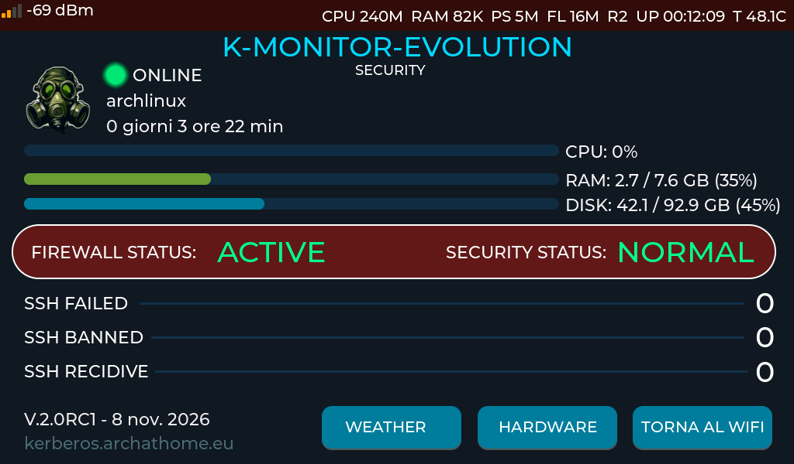
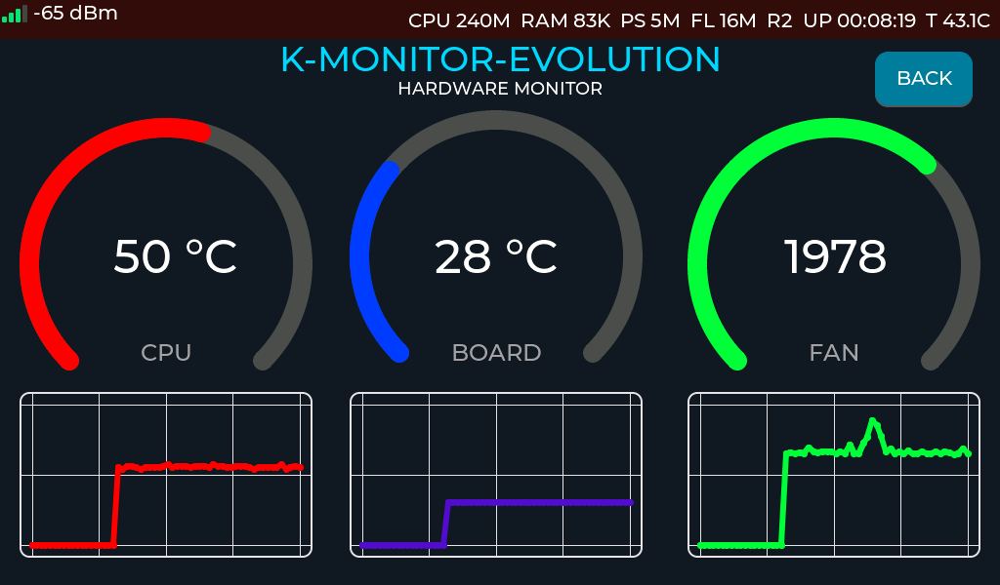
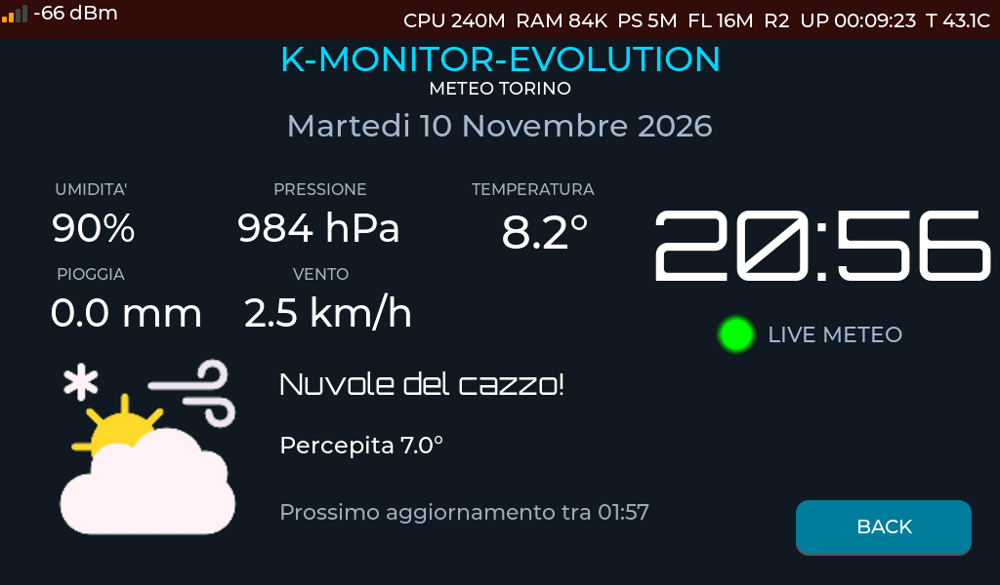
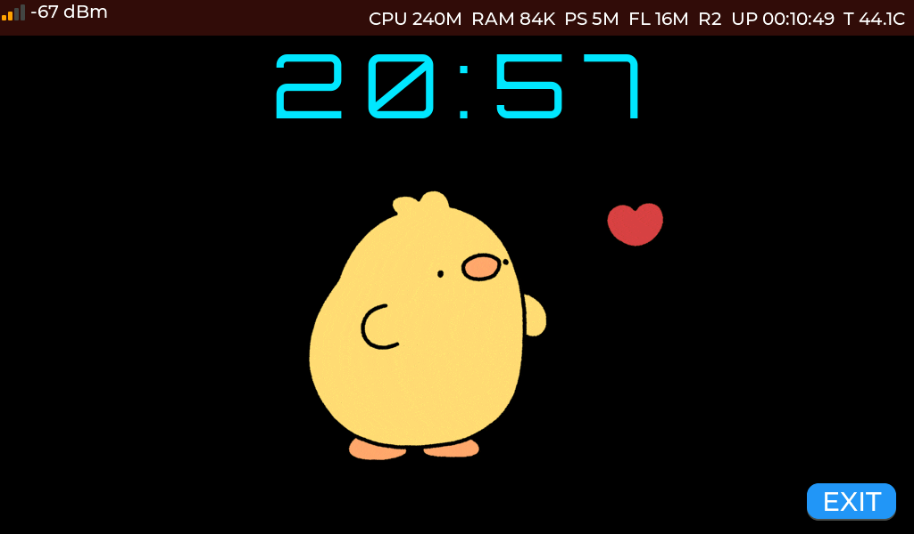
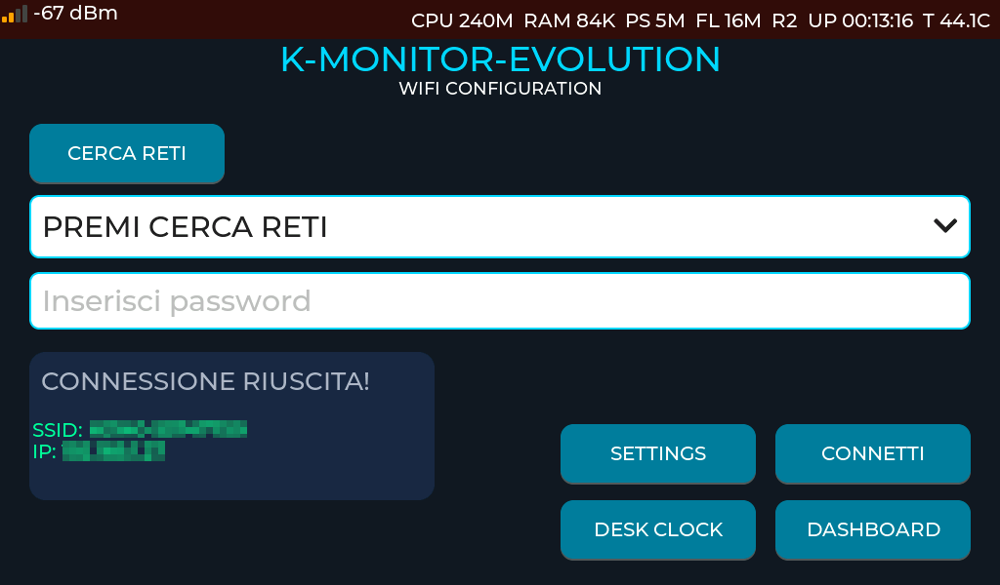
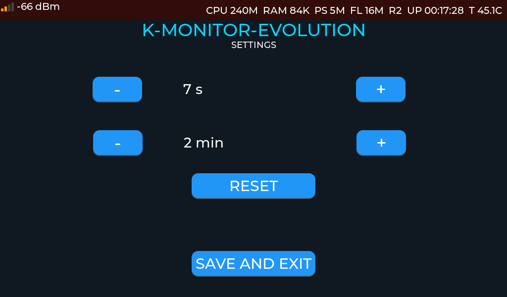

# 🛡️ K-MONITOR

### Il tuo HomeLAB sotto controllo. E senza dover aprire 47 terminali.

K-MONITOR è un monitor touch per HomeLAB basato su **ESP32-S3**, progettato per tenere sotto controllo il tuo server senza dover continuamente aprire SSH, dashboard, terminali e altri simpatici strumenti con cui complicarsi la vita.

Interroga periodicamente il server tramite una piccola API JSON e mostra su diverse schermate tutto quello che succede: CPU, RAM, dischi, temperature, ventole, uptime e sicurezza.

Ma non si limita a fare il guardone del server: ha anche un orologio NTP, informazioni meteo, un tamagochi animato con GIF personalizzabile e persino un'interfaccia web per caricare immagini e catturare screenshot del display.

Insomma, un piccolo centro di controllo per il tuo HomeLAB. Con meno NASA e più bestemmie quando qualcosa va offline.

> **Nota:** K-MONITOR è un progetto personale, sviluppato e testato sul mio hardware e sulla mia rete. Funziona nel mio ambiente, ma se decidi di adattarlo al tuo, qualche modifica potrebbe essere necessaria. Non è un prodotto commerciale e non promette miracoli. Quelli li lasciamo agli influencer.

---

## 🚀 Cosa sa fare K-MONITOR

### 🖥️ Dashboard del server

La situazione generale del tuo HomeLAB, senza dover chiedere continuamente al server se è ancora vivo.

- Stato ONLINE/OFFLINE con indicatore LED.
    
- Hostname, utilizzo CPU, RAM e disco.
    
- Barre grafiche con valori e percentuali.
    
- Uptime in giorni, ore e minuti.
    
- Sezione sicurezza con SSH, IP bannati, recidivi, firewall e fail2ban.
    
- Livelli di allerta `OK`, `WARNING`, `CRITICAL` e `UNKNOWN`.
    

### 🌡️ Schermata hardware

Per chi vuole sapere anche se il server sta sudando.

- Temperatura CPU.
    
- Temperatura della scheda.
    
- Velocità della ventola in RPM.
    
- Tre grafici storici da 60 campioni, aggiornati continuamente.
    

### 🌤️ Meteo e orologio

Per sapere se fuori piove mentre dentro il server sta andando a fuoco.

- Temperatura, temperatura percepita e umidità.
    
- Vento, pressione e precipitazioni.
    
- Icona e descrizione delle condizioni meteorologiche.
    
- Dati forniti da [Open-Meteo](https://open-meteo.com/), senza API key.
    
- Orologio e data in italiano, sincronizzati via NTP.
    
- Fuso orario Europa/Roma, con gestione automatica dell'ora legale.
    
- Countdown al prossimo aggiornamento meteo.
    


### 🕰️ Desk Clock e GIF animata

Perché un monitor di sistema senza un animaletto animato sarebbe decisamente meno simpatico.

- Orologio digitale sincronizzato.
    
- GIF animata personalizzabile.
    
- GIF caricabile direttamente dal browser.
    


### 📡 WiFi

K-MONITOR non ha voglia di farti configurare la rete ogni volta.

- Scansione delle reti WiFi direttamente dal touchscreen.
    
- Tastiera virtuale per inserire la password.
    
- Fino a 10 reti memorizzate nella flash.
    
- Connessione automatica all'avvio, scegliendo tra le reti salvate quella con il segnale migliore.
    
- Se la connessione automatica fallisce, ritorno alla scansione manuale.
    
- Indicatore WiFi sempre visibile, con quattro barre colorate e valore in dBm.
    


### ⚙️ Impostazioni

Poche cose, ma quelle giuste.

- Aggiornamento server: da 1 a 60 secondi (default 5).
    
- Aggiornamento meteo: da 1 a 120 minuti (default 10).
    
- Salvataggio automatico nella memoria flash.
    
- Ripristino dei valori predefiniti.
    


### 🌐 Interfaccia web

Una piccola pagina web, protetta da password, per:

- Caricare una nuova GIF sulla microSD.
    
- Acquisire uno screenshot BMP del display direttamente dal browser.
    

Niente software aggiuntivo, niente magie nere. Basta un browser.

---

## 🔧 Hardware: cosa serve

|Componente|Descrizione|
|---|---|
|**Waveshare ESP32-S3-Touch-LCD-5B**|Display touch capacitivo da 5", 1024×600, ESP32-S3, PSRAM e 16 MB flash|
|**MicroSD**|Formattata FAT32, per conservare la GIF|
|**Cavo USB**|Programmazione e collegamento alla scheda|

**Due particolarità hardware:**

- Il chip select della microSD passa attraverso l'espansore I/O CH422G, precisamente EXIO4. Il firmware se ne occupa durante `init_sd_card()`.
    
- Il display utilizza un bus RGB. Per evitare fastidiosi glitch grafici, il firmware usa la PSRAM per i framebuffer e un bounce buffer da 20 righe.
    

Sì, anche il display ha bisogno di qualche attenzione. Non è che possiamo pretendere tutto gratis dalla povera ESP32.

---

## 📁 Dentro il repository

La struttura del progetto è questa:

```
.
├── Kerberos.ino
├── esp_lv_adapter_arduino.cpp
├── esp_lv_adapter_arduino.h
├── esp_panel_board_custom_conf.h
├── secrets.example.h
├── .gitignore
│
├── tools/
│   └── capture_display.py
│
└── user_interface/
    └── KerberosUI/
        ├── *.eez-project
        ├── Orbitron-VariableFont_wght.ttf
        └── src/
```

I protagonisti:

- `Kerberos.ino`: il cervello dell'operazione.
    
- `esp_lv_adapter_arduino.*`: collegamento tra ESP32_Display_Panel e LVGL.
    
- `esp_panel_board_custom_conf.h`: configurazione hardware della scheda.
    
- `secrets.example.h`: modello della configurazione privata.
    
- `tools/`: strumenti di supporto, incluso lo screenshot via seriale.
    
- `user_interface/`: interfaccia grafica realizzata con EEZ Studio.
    

**Attenzione:** `secrets.h` non è incluso nel repository e non deve essere pubblicato su GitHub. Per una buona ragione, visto che contiene credenziali.

---

## 💻 Software e librerie

Queste sono le versioni utilizzate per compilare e testare il progetto.

|Componente|Versione|
|---|---|
|Arduino IDE|2.x|
|Core ESP32 Espressif|3.3.12|
|LVGL|9.6.0|
|ESP32_Display_Panel|1.0.4|
|esp-lib-utils|0.3.0|
|ESP32_IO_Expander|1.1.1|
|ArduinoJson|7.4.3|

Le librerie WiFi, HTTPClient, WebServer, Preferences, SD, SPI e FS sono già comprese nel core ESP32.

### Configurazione LVGL

Nel file `lv_conf.h` verifica che siano presenti:

- `LV_USE_GIF`: abilitato.
    
- File system Arduino SD: abilitato con lettera `S`.
    
- Font Montserrat 20: abilitato.
    

La GIF viene caricata dal percorso:

```
S:/images/kenny.gif
```

Se manca qualche configurazione, potresti ritrovarti con un'interfaccia perfettamente funzionante e un tamagochi desaparecido.

---

## 📦 Installazione

### 1. Clonare il repository

Arduino IDE vuole che il nome della cartella coincida con quello dello sketch. Non chiedermi perché, è Arduino.

```
cd ~/Arduino
git clone https://github.com/giuseppetnt/k-monitor.git Kerberos
cd Kerberos
```

### 2. Installare core e librerie

Da Arduino IDE:

**Boards Manager**

- Installa `esp32 by Espressif Systems`, versione 3.3.x.
    

**Library Manager**

- LVGL
    
- ESP32_Display_Panel
    
- ESP32_IO_Expander
    
- esp-lib-utils
    
- ArduinoJson
    

Rispetta le versioni indicate nella sezione precedente, soprattutto per ArduinoJson: serve la versione 7.

### 3. Installare KerberosUI

La grafica generata da EEZ Studio è una libreria Arduino separata.

```
mkdir -p ~/Arduino/libraries/KerberosUI
cp -r user_interface/KerberosUI/src ~/Arduino/libraries/KerberosUI/
```

Crea il file:

`~/Arduino/libraries/KerberosUI/library.properties`

Contenuto:

```
name=KerberosUI
version=1.0.0
author=giuseppetnt
maintainer=giuseppetnt
sentence=Interfaccia grafica di K-MONITOR generata con EEZ Studio.
paragraph=Schermate LVGL per il monitor del server.
category=Display
url=https://github.com/giuseppetnt/k-monitor
architectures=esp32
includes=KerberosUI.h
depends=lvgl
```

### 4. Preparare la configurazione

```
cp secrets.example.h secrets.h
```

Apri `secrets.h` e inserisci i tuoi dati.

### 5. Compilare e caricare

Seleziona la scheda e le impostazioni indicate nella sezione successiva, premi **Verifica** e poi **Carica**.

### 6. Preparare la microSD

Facoltativo, ma consigliato.

- Formatta la scheda in FAT32.
    
- Crea la cartella `images`.
    
- Copia al suo interno la GIF con il nome `kenny.gif`.
    

In alternativa potrai caricarla comodamente dal browser.

---

## ⚙️ Configurazione Arduino IDE

Impostazioni utilizzate durante la compilazione:

|Opzione|Valore|
|---|---|
|Board|Waveshare ESP32-S3-Touch-LCD-5B|
|USB Mode|Hardware CDC and JTAG|
|USB CDC On Boot|Enabled|
|PSRAM|Enabled|
|Flash Mode|QIO|
|CPU Frequency|240 MHz|
|Partition Scheme|app3M_fat9M_16MB|
|Upload Speed|921600|
|Core Debug Level|None|
|Loop Core / Events Core|1 / 1|

Il firmware occupa circa l'87% dello spazio disponibile per il programma: 2,77 MB su 3,14 MB.

C'è ancora spazio, ma non abbastanza per caricarci dentro mezzo Internet. Occhio a font, immagini e nuove funzionalità.

### FQBN per Arduino CLI

```
esp32:esp32:waveshare_esp32_s3_touch_lcd_5B:UploadSpeed=921600,USBMode=hwcdc,CDCOnBoot=cdc,PartitionScheme=app3M_fat9M_16MB,PSRAM=enabled,FlashMode=qio,CPUFreq=240,LoopCore=1,EventsCore=1
```

---

## 🔐 Configurazione di K-MONITOR

Il file `secrets.h` contiene le informazioni private.

Esempio:

```
#pragma once

// API del server
static const char *SERVER_URL =
    "https://il-tuo-server.example/api/status";

// Credenziali interfaccia web
static const char *WEB_USER = "utente";
static const char *WEB_PASS = "una-password-lunga-e-casuale";
```

Le password WiFi non si inseriscono qui: vengono configurate dal touchscreen e memorizzate nella flash tramite Preferences.

### Altre impostazioni

Nel file `Kerberos.ino`, sezione 2 - Configurazione, puoi modificare:

- `WEATHER_URL`: coordinate geografiche per il meteo (valori iniziali impostati su Torino).
    
- Intervalli di aggiornamento.
    
- Soglie e colori.
    
- Altri parametri del monitor.
    

---

## 🖧 Il server: come parla con K-MONITOR

K-MONITOR non si occupa direttamente di raccogliere i dati del server: interroga un endpoint HTTP GET che restituisce un JSON.

Lo script Python che genera questi dati non è incluso nel repository. Puoi utilizzare il tuo servizio, purché rispetti il formato previsto.

Esempio di risposta:

```
{
  "hostname": "mio-server",
  "cpu": 12.5,
  "ram_total": 16777216000,
  "ram_used": 4294967296,
  "disk_total": 500107862016,
  "disk_used": 120259084288,
  "uptime": 864000,
  "cpu_temp": 48,
  "temp1": 41,
  "fan1": 1450,
  "security": {
    "level": "OK",
    "ssh_failed": 3,
    "banned_ips": 2,
    "recidive_bans": 0,
    "firewall_active": true,
    "fail2ban_active": true
  }
}
```

### Significato dei campi

|Campo|Significato|
|---|---|
|`hostname`|Nome del server|
|`cpu`|Utilizzo CPU in percentuale|
|`ram_total`, `ram_used`|RAM totale e utilizzata, in byte|
|`disk_total`, `disk_used`|Disco totale e utilizzato, in byte|
|`uptime`|Secondi dall'avvio|
|`cpu_temp`, `temp1`|Temperature CPU e scheda|
|`fan1`|Velocità ventola in RPM|
|`security.level`|Livello di sicurezza|
|`security.ssh_failed`|Tentativi SSH falliti|
|`security.banned_ips`|IP bannati|
|`security.recidive_bans`|Ban per recidiva|
|`security.firewall_active`|Stato firewall|
|`security.fail2ban_active`|Stato fail2ban|

I livelli di sicurezza accettati sono `OK`, `WARNING`, `CRITICAL` e `UNKNOWN`.

I valori di memoria e disco devono essere espressi in byte, le temperature in °C e l'uptime in secondi.

I campi mancanti vengono interpretati come zero (o `-1` per alcuni contatori di sicurezza).

**Importante:** l'endpoint deve utilizzare HTTPS e rispondere entro 4 secondi.

---

## 🚦 Primo avvio

Accendi K-MONITOR e lascia che faccia il suo lavoro.

1. La scheda avvia automaticamente la scansione WiFi.
    
2. Se trova una rete già memorizzata, prova a collegarsi scegliendo quella con il segnale migliore.
    
3. Se è il primo avvio, premi `Scan`, seleziona la rete, inserisci la password e premi `Connect`.
    
4. Le credenziali vengono salvate per gli avvii successivi.
    
5. Una volta connesso, compare la possibilità di accedere alla dashboard.
    

Se la connessione automatica riesce, la dashboard si apre dopo 2 secondi. Se invece fallisce entro 30 secondi, K-MONITOR torna alla scansione manuale.

Dalle schermate puoi navigare tra dashboard, BTOP, meteo, orologio, tamagochi e impostazioni.

Gli intervalli di aggiornamento si modificano dalla schermata dedicata e vengono salvati nella flash.

---

## 🌐 Interfaccia web

Una volta collegato al WiFi, K-MONITOR avvia un piccolo web server sulla porta 80.

Apri il browser da un dispositivo collegato alla stessa rete:

```
http://IP-DELLA-SCHEDA/
```

L'indirizzo IP è visibile nella schermata WiFi.

Ti verranno richiesti utente e password configurati in `secrets.h`.

|Percorso|Funzione|
|---|---|
|`/`|Menu principale|
|`/upload`|Caricamento GIF sulla microSD|
|`/screenshot`|Screenshot BMP a 24 bit del display|

### Upload GIF

La GIF viene salvata in:

```
/images/kenny.gif
```

Il caricamento utilizza un file temporaneo, che viene rinominato solo quando il trasferimento è completo. Così, se qualcosa va storto, la vecchia GIF resta al suo posto.

**Dopo aver caricato una GIF, riavvia la scheda.**

Evita inoltre di effettuare l'upload mentre il tamagochi è aperto: LVGL potrebbe stare leggendo la stessa scheda SD.

### Screenshot

Il browser restituisce un'immagine BMP del display, compreso l'indicatore WiFi.

Se i colori risultano invertiti (rosso e blu scambiati), potrebbe essere necessario correggere l'ordine dei byte nella funzione `web_handle_screenshot()`.

---

## 🎨 Personalizzazione

Vuoi cambiare qualcosa? Ecco dove mettere le mani.

|Cosa|Dove|
|---|---|
|URL server e credenziali web|`secrets.h`|
|Coordinate meteo|`WEATHER_URL`|
|Intervalli aggiornamento|`DEFAULT_*`, `POLL_*`, `WEATHER_*`|
|Fondo scala temperature|`TEMP_MAX_C`|
|Fondo scala ventola|`FAN_MAX_RPM`|
|Indicatore WiFi|Sezione 18b: `WIFI_ICON_X/Y`, `WIFI_SHOW_DBM`|
|Numero campioni grafici|`CHART_POINTS`|
|Fuso orario|`configTzTime()`|
|Percorso GIF|`GIF_PATH` e `lv_gif_set_src()`|

### Una nota sul meteo

La funzione `weather_description()` traduce i codici meteorologici in descrizioni personalizzate.

Il linguaggio è volutamente poco istituzionale e contiene qualche espressione colorita.

Perché anche il meteo, quando fa schifo, deve poterlo dire chiaramente.

---

## 🖌️ Modificare la grafica con EEZ Studio

L'interfaccia grafica è realizzata con [EEZ Studio](https://www.envox.eu/studio/studio-introduction/).

I file di progetto si trovano in:

```
user_interface/KerberosUI/
```

Per modificare l'interfaccia:

1. Apri `KerberosUI.eez-project`.
    
2. Modifica schermate, widget e stili.
    
3. Esporta il progetto.
    
4. Controlla che la cartella di destinazione sia quella corretta.
    
5. Ricompila il firmware.
    

È presente anche una versione sperimentale `KerberosUI-V3-BETA`.

**Attenzione ai nomi dei widget!**

Il firmware richiama direttamente gli oggetti generati da EEZ Studio, ad esempio:

```
objects.lbl_cpu
objects.chart_cpu
objects.clock_tamagochi
```

Se rinomini o elimini un widget, ricordati di aggiornare anche il firmware. Altrimenti Arduino ti presenterà il conto sotto forma di errori di compilazione.

---

## 🔒 Sicurezza: qui non si scherza

K-MONITOR è un progetto domestico, ma questo non significa che possiamo distribuire password e dati sensibili come volantini al supermercato.

Ci sono alcune limitazioni importanti da conoscere.

### Web server HTTP

L'interfaccia web utilizza HTTP con autenticazione Basic.

Le credenziali viaggiano in chiaro sulla rete locale.

**Non esporre mai la porta 80 di K-MONITOR direttamente su Internet.**

### Certificati TLS

Il firmware utilizza `setInsecure()` nelle connessioni HTTPS verso il server e il servizio meteo.

Questo significa che non verifica l'identità del server remoto: un eventuale attaccante sulla rete potrebbe intercettare o falsificare le comunicazioni.

È una limitazione da correggere introducendo una verifica del certificato o della CA.

### API del server

La richiesta API non invia attualmente un token di autenticazione.

Se l'endpoint è accessibile pubblicamente, chiunque ne conosca l'indirizzo potrebbe leggere le statistiche del server, comprese quelle relative alla sicurezza.

Proteggilo con autenticazione, whitelist IP o VPN.

### Credenziali e dati

- Non pubblicare mai `secrets.h`.
    
- Le password WiFi sono memorizzate in chiaro nella flash dell'ESP32.
    
- Gli screenshot possono contenere hostname, IP e informazioni sulla sicurezza.
    

Prima di condividere uno screenshot, controlla cosa stai mostrando.

**K-MONITOR è pensato per una rete fidata. Non è un dispositivo da esporre direttamente su Internet.**

---

## 🧯 Problemi e limitazioni

Qualche problema può capitare. Siamo pur sempre nel mondo ESP32, non in quello delle favole.

|Problema|Possibile causa|
|---|---|
|GIF non visibile|`LV_USE_GIF` disabilitato o percorso SD errato|
|Scheda SD non rilevata|FAT32, collegamento CH422G o inizializzazione|
|WiFi non si collega|Password errata o rete non disponibile|
|Dashboard vuota|API non raggiungibile o JSON non conforme|
|Dati server a zero|Campi JSON mancanti o nomi errati|
|Screenshot con colori sbagliati|Ordine dei byte del framebuffer|

### Limiti conosciuti

- Il server Python che produce il JSON non è incluso.
    
- Il web server integrato non utilizza HTTPS.
    
- I certificati TLS remoti non vengono verificati.
    
- Le credenziali WiFi non sono cifrate nella flash.
    
- Lo spazio disponibile per il firmware è limitato dalla partizione scelta.
    

Il progetto è in evoluzione: alcune funzionalità e miglioramenti potranno arrivare nelle versioni successive.

---

## ❤️ Crediti

K-MONITOR non sarebbe possibile senza il lavoro di chi sviluppa e mantiene queste librerie e strumenti.

- [LVGL](https://lvgl.io/) — Motore grafico.
    
- [EEZ Studio](https://www.envox.eu/studio/studio-introduction/) — Progettazione dell'interfaccia.
    
- [Waveshare](https://www.waveshare.com/) — Hardware e librerie di supporto.
    
- [ArduinoJson](https://arduinojson.org/) — Lettura dei dati JSON.
    
- [Open-Meteo](https://open-meteo.com/) — Dati meteorologici.
    
- **Orbitron** — Font incluso nel progetto, distribuito con licenza SIL Open Font License.
    

Un grazie a tutti gli sviluppatori che rendono possibile costruire progetti del genere senza dover reinventare ogni singola ruota.

---

## 📜 Licenza

Il codice originale di K-MONITOR è distribuito con licenza **MIT**. Consulta il file `LICENSE` per i dettagli.

Le librerie utilizzate e il font Orbitron mantengono le rispettive licenze originali.

In breve: puoi studiare, modificare e utilizzare il progetto nel rispetto delle licenze applicabili.

---

**K-MONITOR — Perché controllare il proprio HomeLAB è importante. Farlo con un display touch e un tamagochi è decisamente più divertente.** 🛡️
